# From Play to Prevention
## Modular launcher theme explorations

Visual exploration only. The current display and capability contract is defined in [the API](../api.md). These images predate the latest API changes; never derive behaviour or supported modes from the drawings.

24 November 2026

Twelve themes, each with two sketches and two graphical directions, each graphical direction shown on mobile and desktop. 72 views in total. The visual proposals are exploratory; no graphic identity is selected.

Documentation is in English, interface controls are in French, and experience titles are unchanged.

### Current experience catalogue
- Tik Tak Tik Tak
- The Secret of St Christophe
- Marked
- Without a Trace
- Echo
- Le groupe parallèle

### Shared architecture

All themes share the same catalogue, metadata, iframe lifecycle, local and external application support, deployments and message protocol. Themes only change presentation. A configured default, automatic preselection and manual selection are possible. Each theme must remain responsive. No immersive metadata flag is required. Experiences may request navigation hide/show or exit using the existing protocol.

Illustrations are placeholders, not claims about project content. Image lettering may vary slightly; the catalogue above is authoritative. Each plate reads top to bottom: sketch, direction A, direction B; left is mobile, right is desktop.

## 01 Bibliothèque d’expériences

A catalogue of six experience cards, browsing and categories, clear library rather than video streaming.

**Mobile:** One or two columns of cards with title labels and visible bottom navigation.

**Desktop:** Three-column two-row grid and compact left category sidebar.

**Why consider it:** Easy to scan and extend as new experiences arrive.

**What to test:** Keep category labels meaningful. Any categories visible in these mockups are placeholders until teams supply real metadata.

**Direction A:** Quiet contemporary editorial library: warm ivory, ink blue, electric blue accent, geometric sans-serif, generous whitespace and bold flat abstract cover thumbnails.

**Direction B:** Playful modular card collection: pale mint, charcoal, warm orange, rounded cards, friendly humanist type, small geometric cover patterns.

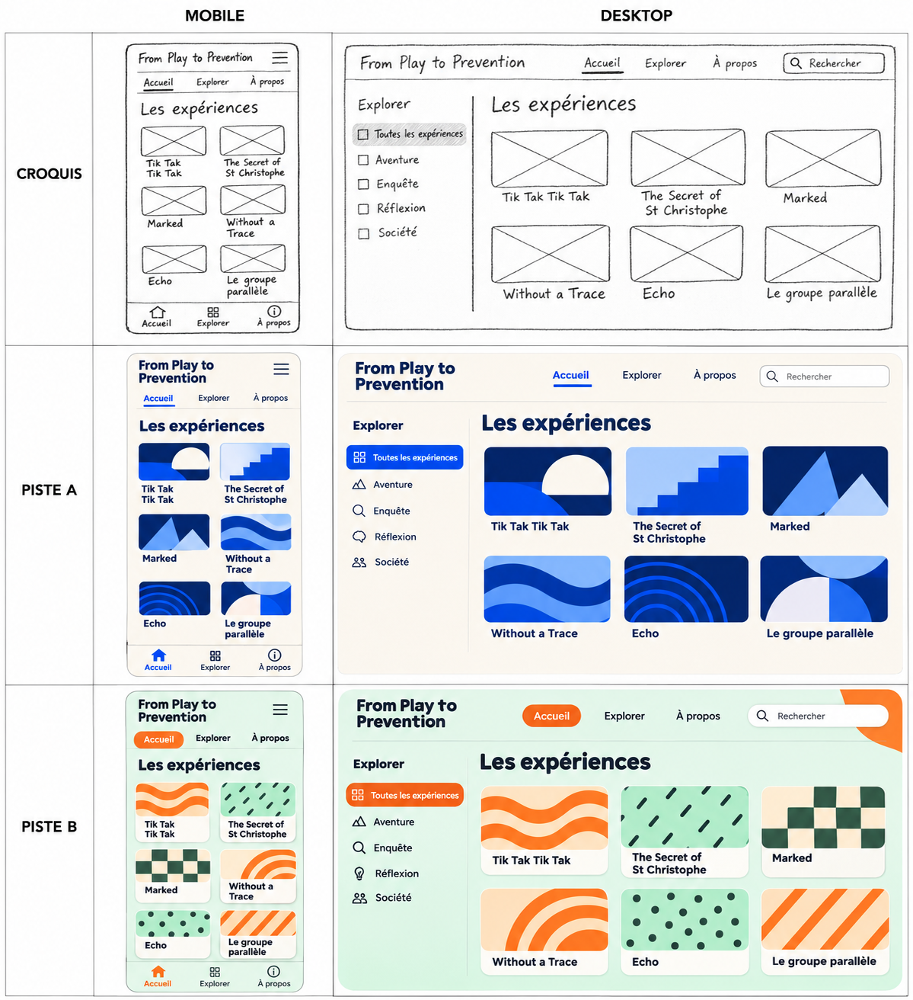

## 02 Téléphone fictif

Fictional smartphone app launcher; experience icons, optional generic notes/gallery tools visually secondary.

**Mobile:** Full-bleed home screen WITHOUT a second physical phone frame. Six app icons with titles, bottom Accueil.

**Desktop:** A simple physical fictional phone frame centred on a spacious desktop page with exactly the same app home screen inside.

**Why consider it:** Familiar application shortcuts and a coherent fictional device.

**What to test:** A phone frame can constrain desktop games. The frame must be optional during play, and fake device status indicators are decorative only.

**Direction A:** Contemporary calm digital device: midnight navy wallpaper, ice blue app tiles, white labels, crisp minimal icons, no real brands.

**Direction B:** Tactile bright device: cream wallpaper, coral and lilac tiles, soft drawn app icons, charcoal readable labels, contemporary playful look.

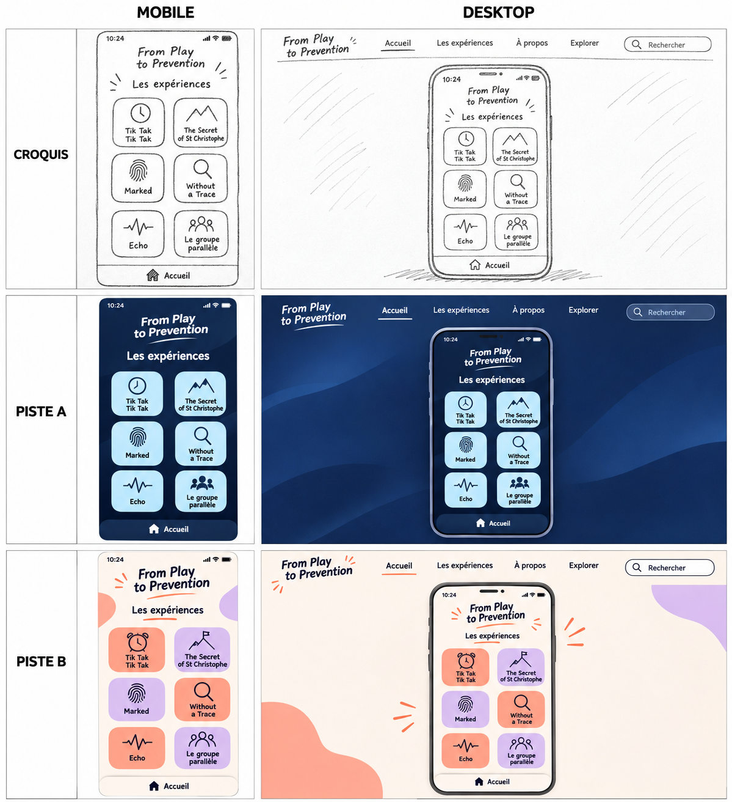

## 03 Bureau numérique

Fictional computer desktop with application shortcuts and folders; playful exploration inspired by web desktops.

**Mobile:** Touch-friendly shortcut grid with a single active panel and persistent bottom home bar, no tiny overlapping windows.

**Desktop:** Expansive desktop with six readable shortcut icons and a simple taskbar, one catalogue window may be open.

**Why consider it:** Supports playful tools and unexpected uses of familiar software conventions.

**What to test:** Avoid tiny icons and overlapping windows on mobile. The first version still runs only one experience at a time.

**Direction A:** Restrained modern workspace: mist grey, cobalt blue, crisp thin borders, flat icons and orderly spacing.

**Direction B:** Invented retro desktop: warm beige, dark plum, muted orange, pixel-influenced iconography and title bars without copying Windows or any brand.

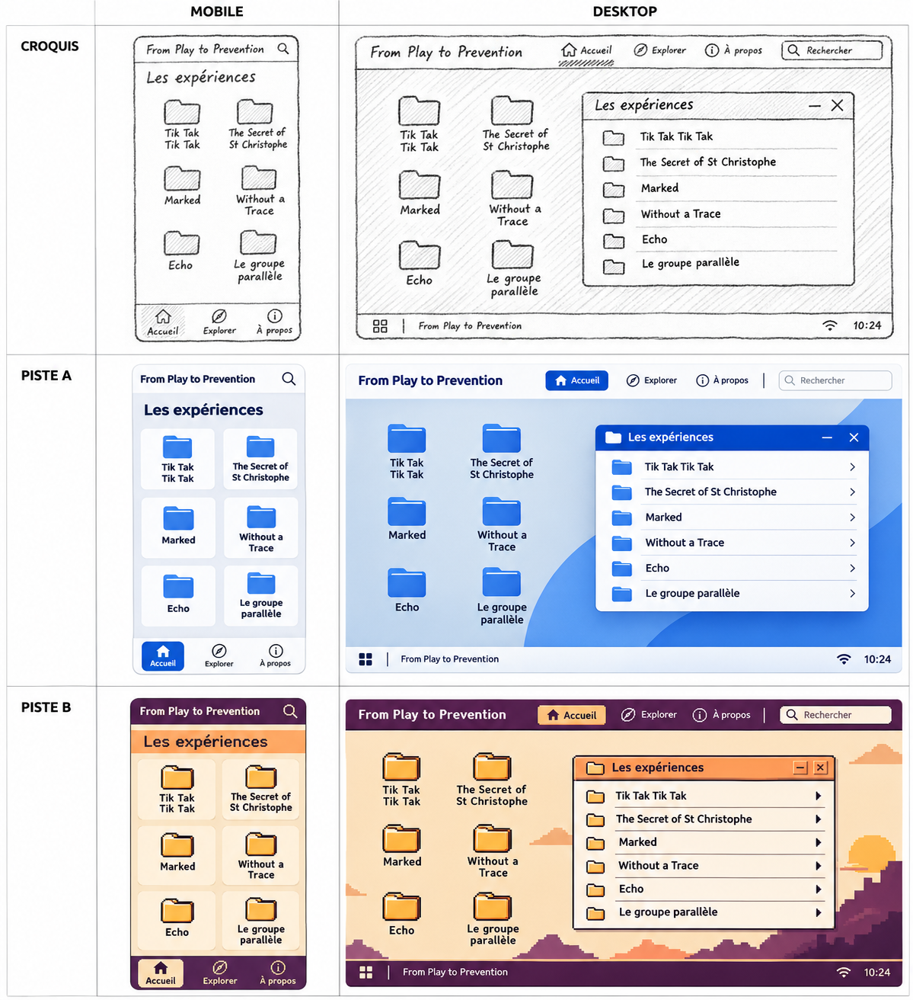

## 04 Carnet d’exploration

A notebook index where the six experiences are labelled pages and tabs, not a school worksheet.

**Mobile:** Single portrait notebook page with six linked entries and index tabs.

**Desktop:** Open notebook spread with clickable index at left and six entries across the spread.

**Why consider it:** A readable index gives a sense of exploration without a complex map.

**What to test:** Keep tabs large enough for touch. Paper textures must never reduce contrast or obscure labels.

**Direction A:** Field notebook: ivory paper, graphite type, forest green tabs, restrained handwritten annotations and simple line stamps.

**Direction B:** Contemporary creative journal: lavender paper accents, vermilion tabs, clean editorial type, collage corners and expressive stickers used sparingly.

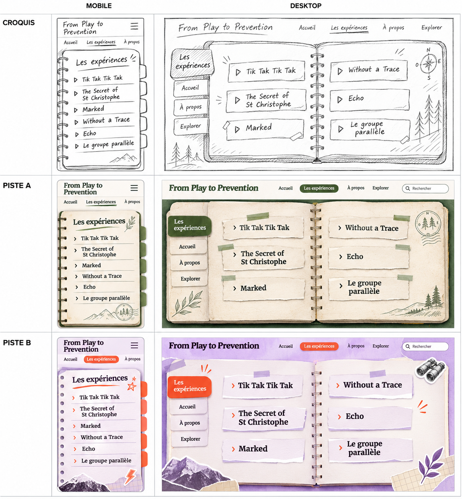

## 05 Carte de lieux

A fictional map containing six neutral numbered locations, each labelled with one experience title. Location imagery is navigation decoration, not claims about stories.

**Mobile:** Simplified vertical neighbourhood map and a visible toggle Carte / Liste, large tappable markers.

**Desktop:** Wider illustrated map with six large location labels and a small list panel.

**Why consider it:** Makes the collection feel like a place worth exploring.

**What to test:** Provide a fully usable list alternative. Buildings are arbitrary navigation metaphors and do not establish story locations.

**Direction A:** Calm illustrated neighbourhood: sage green, sand, deep blue, simple isometric buildings, friendly clear labels.

**Direction B:** Graphic schematic city: pale grey grid, black, cyan and coral blocks, top-down flat vector zones, high-contrast numbered markers.

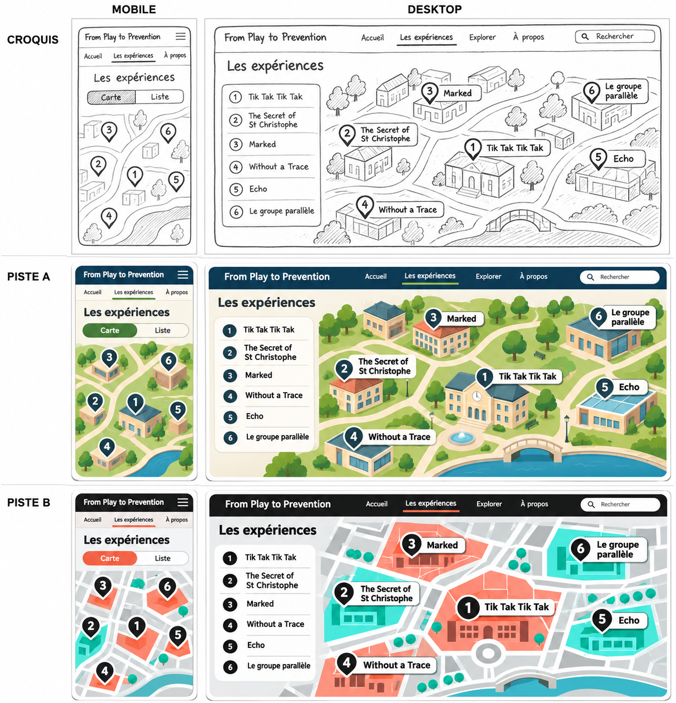

## 06 Station de départ

Experiences are destinations on a departure board, no countdown pressure, tickets or completion status invented.

**Mobile:** Vertical departure list with six destinations and large Explorer buttons.

**Desktop:** Large departure board with six destination rows, subtle line-map accents.

**Why consider it:** A departure board makes available choices explicit and easy to compare.

**What to test:** Do not add schedules, urgency or locked routes without a purpose. Preserve full titles and large launch controls.

**Direction A:** Modern transit wayfinding: white, navy, yellow route markers, large precise sans-serif and strong alignment.

**Direction B:** Retro-future travel terminal: deep petrol, mint glowing text, cream labels, soft amber highlights, refined readable departure-board aesthetic.

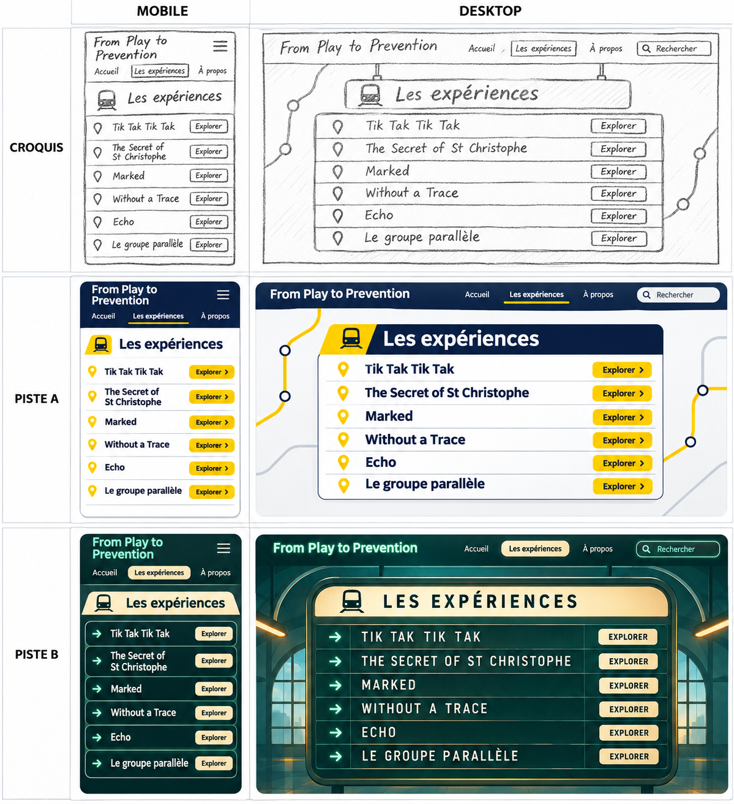

## 07 Constellation

Six experience stars in an explorable sky; any connecting lines only decorative suggestions, no claimed narrative relations.

**Mobile:** Compact vertically arranged cluster of six large labelled stars and a Liste alternative.

**Desktop:** Wider star field with six labels, gentle grouping and Liste option.

**Why consider it:** Offers a distinctive spatial identity and room for gentle discovery.

**What to test:** Provide a list alternative and reduced motion. Lines between stars must not imply verified relationships between projects.

**Direction A:** Quiet observatory: midnight blue, warm white stars, restrained gold, elegant typography and generous negative space.

**Direction B:** Daylight abstract cosmos: pale peach and lilac background, cobalt circles, coral orbit lines, bold playful editorial typography.

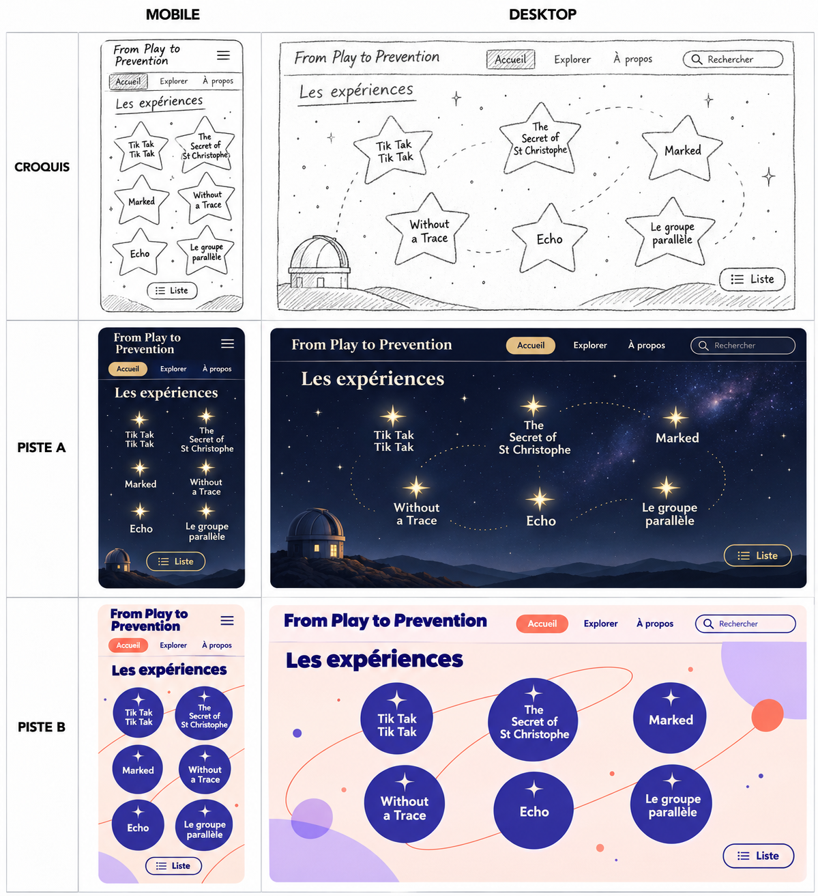

## 08 Exposition interactive

Six experiences presented as installations or artworks with title labels and launch buttons.

**Mobile:** Vertical sequence of six installation cards, one prominent item per row.

**Desktop:** Gallery wall or wide grid of six framed installation previews, simple exhibit navigation.

**Why consider it:** Gives each project a visible place while accommodating different visual identities.

**What to test:** Keep artworks clickable and labels readable. Do not turn the gallery into a mandatory 3D walkthrough.

**Direction A:** White-cube gallery: white space, black typography, thin frames, minimal small red accent, abstract geometric exhibit placeholders.

**Direction B:** Immersive contemporary exhibition: charcoal walls, electric violet and acid green lighting accents, large vivid abstract framed works and clean white labels.

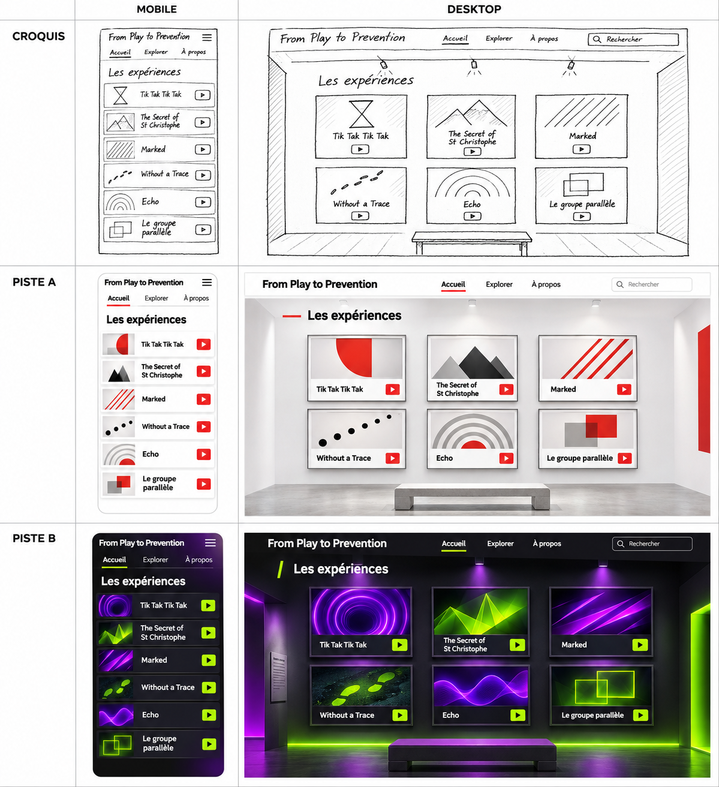

## 09 Boîte à expériences

A collection of six everyday symbolic objects that each launch one experience. Objects are arbitrary navigation metaphors, no invented plot.

**Mobile:** Orderly touch-friendly two-column tray with six object cards and labels.

**Desktop:** Six objects arranged on a table or in a compartment box with clear labels.

**Why consider it:** Creates curiosity through tangible objects and playful associations.

**What to test:** Always show text labels. Objects shown here are illustrative shortcuts, not factual representations of the game content.

**Direction A:** Tactile studio tray: natural cream paper, terracotta and deep teal objects, subtle material textures, warm clear typography.

**Direction B:** Bright geometric toybox for teenagers: cobalt, coral and yellow objects on pale grey, stylised 3D paper forms, crisp type, never childish.

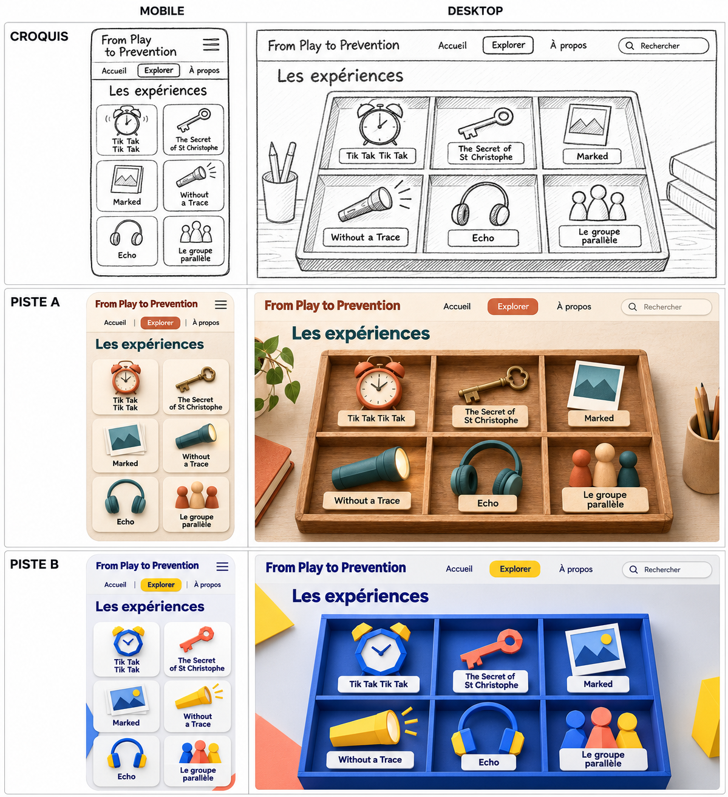

## 10 Tableau de liens

Six pinned cards as experience shortcuts, grouped visually with neutral decorative connections. No crime-board tone or invented relationships.

**Mobile:** Stacked pinned cards and category tabs; all six reachable by scrolling.

**Desktop:** Roomy pinboard of six labelled cards with subtle connectors and navigation.

**Why consider it:** Can express a collection that grows and evolves over time.

**What to test:** Do not require dragging or spatial navigation. Connectors in these images are decorative, not a taxonomy or story graph.

**Direction A:** Real studio board: cork tan, cream cards, green pins, black sans-serif, subtle tactile shadows.

**Direction B:** Digital collaborative canvas: cool white grid, periwinkle and lime cards, charcoal connectors, rounded modern sans-serif and minimal shadows.

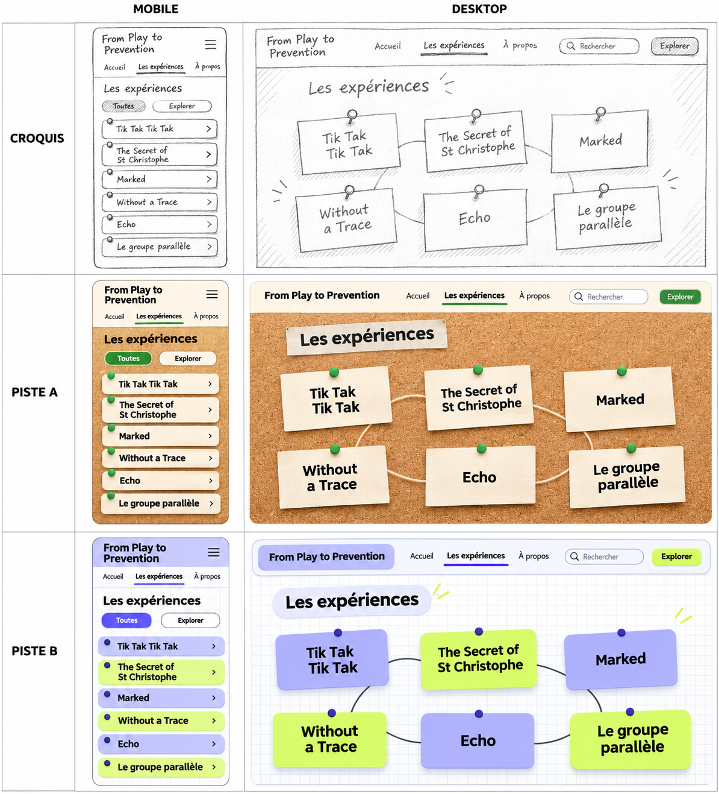

## 11 Médiathèque

A browsable media catalogue of six interactive works with thumbnails and launch actions, no invented ratings, duration or content genres.

**Mobile:** Vertical catalogue with prominent title thumbnails and a simple search field.

**Desktop:** Wide catalogue with featured title and rows or grid of all six works.

**Why consider it:** Supports discovery with familiar catalogue and featured-item patterns.

**What to test:** Do not invent ratings, completion times or promotional claims. Any featured item is illustrative, not a ranking.

**Direction A:** Cinematic catalogue: deep navy, white type, restrained coral accent, large abstract cover artwork, no film stills invented.

**Direction B:** Public cultural media collection: warm white, black editorial typography, blue tabs, colourful geometric thumbnails and refined card borders.

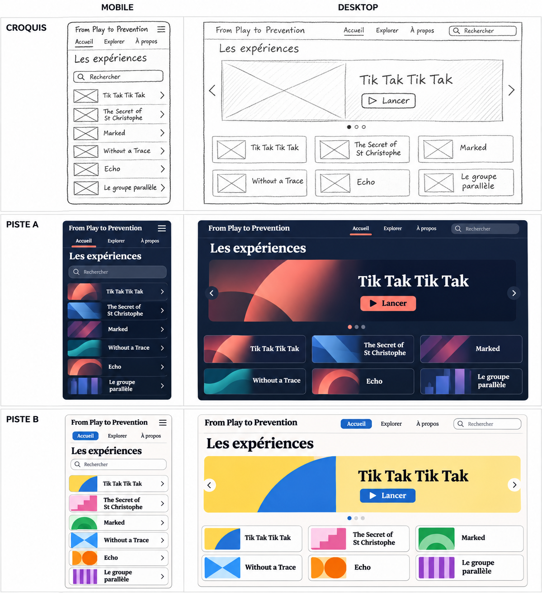

## 12 Portail à plusieurs regards

Entry through perspectives on digital social life: Participer, Observer, Recevoir, Intervenir. Show all six experiences in a separate collection; do NOT imply specific games belong to particular roles.

**Mobile:** Four large stacked perspective choices plus Toutes les expériences section containing six titles.

**Desktop:** Four viewpoint panels across the top and a six-title collection below.

**Why consider it:** Connects the hub to viewpoints in digital social life.

**What to test:** Role-to-experience mappings require editorial review with the teams. All six titles remain directly accessible without choosing a role.

**Direction A:** Human-centred editorial portal: warm white, ink black, ochre and teal, abstract overlapping silhouettes and clear type.

**Direction B:** Graphic multi-window portal: dark indigo, coral and cyan translucent panes, geometric perspectives, bold contemporary type and luminous restrained accents.

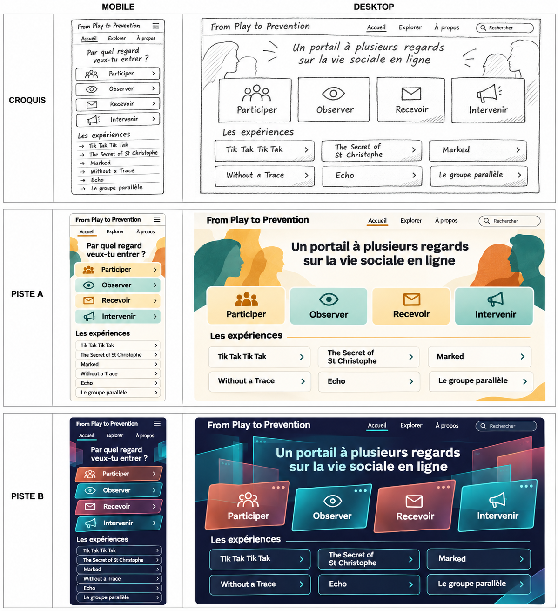

## Workshop discussion

Compare the sketches first. Test finding a title, launching and leaving it, keyboard access, mobile space and catalogue growth before selecting a graphic treatment.
