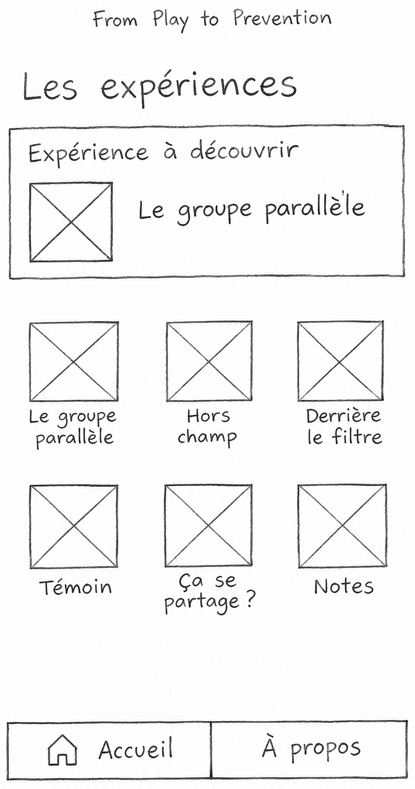
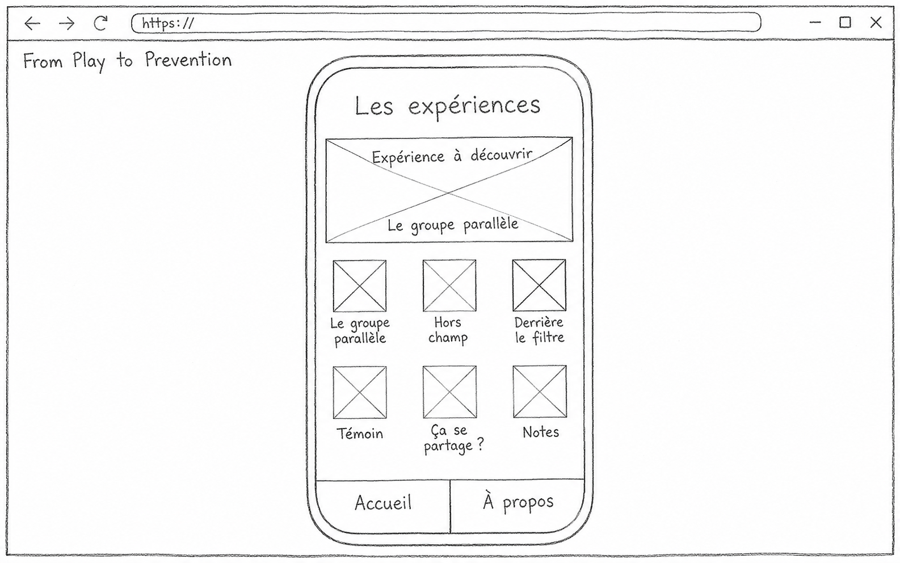

# Launcher specification

Baseline consolidated on 24 November 2026. This is a specification project, not an implemented launcher. Read decisions.md for confirmed direction and open-questions.md for remaining choices.

## Purpose and language

Build a modular, themeable launcher that brings together small prevention games and other interactive applications for French-speaking young people aged 12–16. Players explore situations involving digital social life, relationships, exclusion and cyberbullying through different experiences.

The launcher is an experience hub, not a single game. Each application can have its own narrative, visual style and technology.

**Development language is English:** code identifiers, filenames, API messages, technical documentation and development comments. **The product language is French:** launcher interface, application titles, descriptions, instructions, accessibility labels, errors and experience content. Use `lang="fr"` in published French pages. The English project name “From Play to Prevention” can remain the brand.

## Inspiration and product decisions

[Windows93](https://windows93.net/) inspires an explorable environment full of applications and unexpected uses. [It is as if you were doing work](https://pippinbarr.com/itisasifyouweredoingwork/) inspires familiar interface actions becoming playful experiences. Their retro appearance is not a requirement.

The agreed foundation is:

- A mobile-first modular launcher with interchangeable presentation themes.
- Each theme adapts to mobile and desktop; the fictional phone is one optional theme.
- Theme selection may use a configured default, automatic preselection, manual selection, or automatic preselection with a manual override.
- Responsive adaptation is required within each theme and is independent of theme selection.
- Each experience opens in an iframe inside that interface.
- The launcher owns a navigation bar outside the iframe, with an always-available Home action by default.
- An experience may request that the bar be hidden once its own exit control is ready. No immersive capability declaration is required in metadata.
- The launcher has its own GitHub repository and GitHub Pages deployment, optionally on a dedicated domain.
- Independent teams own their repositories and publish their own applications, normally through GitHub Pages.
- Applications hosted in launcher subfolders use the same integration mechanism as external experiences.
- A catalogue of metadata URLs connects the launcher to its applications.

## Layout sketches — visual design remains open

The following two French-language mockups are earlier explorations of the optional phone theme, not a required launcher layout. The product may use other themes or offer several themes. These mockups are intentionally low-fidelity, monochrome layout sketches. They illustrate content hierarchy, application placement and navigation only. Their hand-drawn appearance is a documentation convention, not a proposed product style. Colours, typography, illustrations, icon design, branding and decorative treatment remain undecided. The labels in these earlier sketches are illustrative. The current experience catalogue is: Tik Tak Tik Tak; The Secret of St Christophe; Marked; Without a Trace; Echo; Le groupe parallèle. Preserve the supplied titles even when they are in English.

### Mobile home screen

The interface uses the actual mobile display. Avoid adding a second simulated operating-system status bar or gesture indicator on the real device. The featured experience card and icon grid are proposed home-screen components.

### Desktop home screen

In this optional theme, the phone is the interaction area. The surrounding page remains neutral; any supporting content or visual treatment will be decided later. Fit the complete phone within the available height where practical; do not simply shrink text to fit a short desktop window. At constrained sizes, allow the layout to become the mobile presentation.

### Shared interaction rules

- Keep navigation in a dedicated layout row, never over important application controls.
- When the bar is hidden, the iframe expands into the released space and the experience responds to resizing.
- Use semantic buttons and links, visible keyboard focus, readable contrast and comfortably sized touch targets; aim for at least 44 × 44 CSS pixels for primary controls.
- Support touch, mouse and keyboard. Respect reduced-motion preferences.
- Do not make hover, a hidden gesture or a keyboard shortcut the only way to complete a task.
- Reserve space for real mobile safe areas and accommodate the on-screen keyboard.
- Preserve a coherent launcher identity without forcing applications to copy its visual style.

## Opening, running and leaving an application

### Default lifecycle

1. The player selects an icon.
2. The launcher records which icon opened the experience, ensures navigation is visible and displays loading feedback.
3. It creates a new iframe using the resolved entry URL and an accessible French title.
4. The experience runs within the available experience area.
5. The player activates the launcher's “Accueil” button, or the experience requests exit.
6. The launcher removes the iframe, clears session-specific listeners and state, restores navigation and shows the home screen.
7. Keyboard focus returns to the initiating icon when it is still present.

Remove the iframe rather than merely covering or hiding it; otherwise its sounds and execution can continue. An iframe being removed does not erase previously saved data or uninstall a service worker registered by the application.

Only the active iframe may control launcher navigation. Reset navigation to visible for every new launch and whenever an iframe is reloaded or navigates to a new document. Applications should normally keep internal navigation within the same document; reloading requires a new integration handshake.

### Leaving is not pausing

The first version closes the running application. Opening it again creates a fresh iframe. Progress resumes only if the application implements a suitable save mechanism. The launcher cannot automatically capture arbitrary application state.

Applications should save meaningful progress during play rather than rely on asynchronous work at exit. A future save-before-close handshake would require a separate agreed protocol and timeout policy.

### New tabs and browser Back

An iframe is the normal launch mode. Opening a new tab can be an explicitly labelled fallback for an incompatible external project; it cannot preserve the launcher wrapper or guarantee an automatic return.

The launcher provides its own Home action and never relies on `window.close()`, the browser Back button or `history.back()` inside an experience. Browser Back behaviour needs testing because iframe navigations can participate in session history. Any shell routing should be designed separately from the message contract.

## PWA, viewport and fullscreen

The launcher may be installable as a PWA. Start with a web app manifest requesting `display: "standalone"`; actual presentation depends on browser and platform support. Provide an appropriate application name, icons, start URL, scope and theme colours for the chosen deployment path.

| Mode | What it changes |
| --- | --- |
| Regular mobile browser | Launcher fills the available viewport; browser controls may remain |
| Installed PWA | Can remove normal browser navigation chrome, depending on platform |
| Navigation hidden | Hides only the launcher's navigation bar |
| API `page` mode | Uses the whole launcher client area without a decorative theme frame |
| Browser Fullscreen API | Separate user-initiated enhancement, subject to browser support |

Implement native fullscreen through the display API in [display and navigation API](api.md), using the launcher root containing both the experience area and launcher controls. Do not require fullscreen for core use. Support is negotiated between theme and experience. When `page` or `fullscreen` is common, the theme must honour expansion; a phone outline is not a mandatory constraint on desktop.

Use responsive viewport units and safe-area handling as appropriate. Test mobile browser toolbar changes, rotation and the software keyboard. An installed launcher does not automatically make external experiences available offline. Offline packaging and update coordination remain separate work.

## State, persistence and future interactions

Version 1 gives each application responsibility for its own state. Locally saved progress must handle unavailable or restricted storage gracefully. Applications sharing an origin should namespace keys using their stable ID; storage and permissions are not separated by repository path.

Cross-application continuity is a future extension: an experience might add a fictional image to Gallery or create a note in Notes. The launcher could mediate these actions through a separately defined data and message contract. No shared gallery, shared storage API, automatic pause/resume, completion dashboard or account system is currently specified.

## Launcher acceptance checks

| Scenario | Expected result |
| --- | --- |
| Built-in and external apps appear together | One consistent catalogue and opening behaviour |
| App with no integration code | Runs in a common non-fullscreen mode with navigation visible; absent metadata support defaults to `theme` |
| Theme and experience advertise different support | Controls reflect the intersection and browser availability |
| Theme button changes mode | Core validates it; theme and experience receive the same effective state |
| Experience requests a mode outside the intersection | Error reported; effective mode preserved |
| No common non-fullscreen layout | Launch blocked with French feedback and a compatible-theme option where available |
| Home while sound is playing | Iframe is removed and its document playback stops |
| Immersive request after exit button is ready | Bar hides and content resizes |
| App requests show or exit | Bar returns or home opens as requested |
| Next application opens after immersive use | Navigation starts visible |
| Message from another window, origin or old session | Ignored |
| Experience requests `page` | Decorative frame removed; client area used; iframe session and navigation visibility preserved |
| Experience requests `theme` | Active theme layout restored without restarting the application |
| Fullscreen request lacks user activation | Common non-fullscreen layout retained, `pending` reported and accessible activation control offered |
| Native fullscreen unsupported or rejected | Common `page`, otherwise common `theme`, remains usable; explicit fallback notification sent |
| User exits native fullscreen | Prior non-fullscreen layout restored and state notification sent |
| Experience exits after requesting fullscreen | Experience-owned fullscreen and pending requests cleaned up |
| One manifest or icon is unavailable | Other experiences remain usable |
| Embedded page is blocked or never becomes ready | French recovery controls remain available; iframe load alone is not proof of success |
| Team deploys an update | Available on a later launch after normal cache revalidation; no live interruption |
| Mobile keyboard or orientation changes | Controls and exit remain reachable |
| Desktop viewport is short or narrow | Launcher remains usable; active theme adapts |
| App is opened directly | Standalone interface still works |

Test representative iOS Safari, Android Chrome and desktop browsers, in browser mode and installed mode where supported. Include at least one local app and one genuinely cross-origin app. Test iframe errors explicitly: a load event alone is not reliable evidence that an application successfully rendered. Apps without a ready signal need non-blocking loading feedback and an accessible way home.

## Remaining design choices

Before implementation, choose the launcher stack, deployment organisation/domain, initial themes, theme contract implementation, compact/wide viewport rule, final visual identity, precise immersive recovery control, and iframe trust/sandbox policy. These do not change the agreed catalogue-and-iframe architecture. Real hardware features, offline experiences, shared data and save-before-close require additional contracts if introduced.

## Related contracts

- [Architecture](architecture.md)
- [API](api.md)
- [Experience integration](experience-integration.md)
- [Theme development](theme-development.md)
- [Technical references](references.md)
